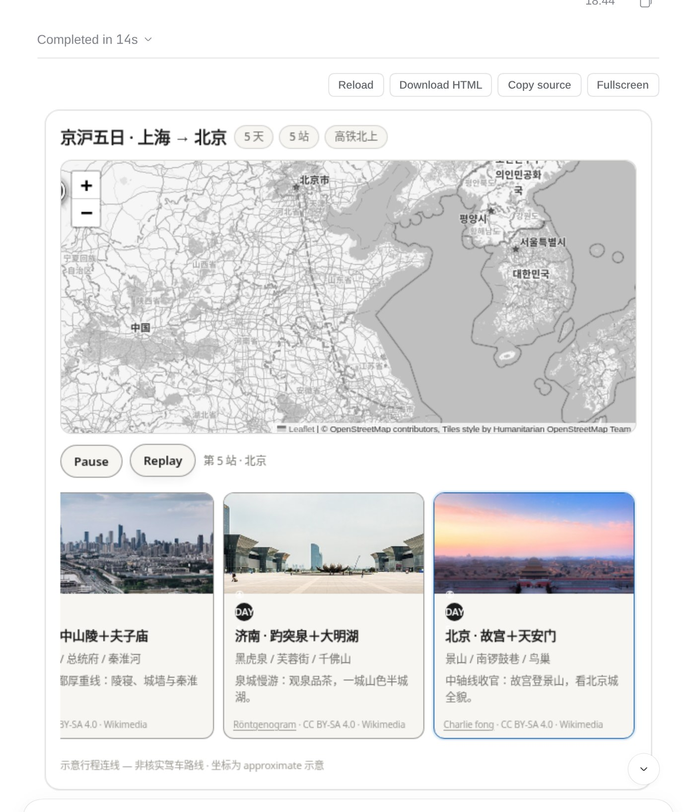
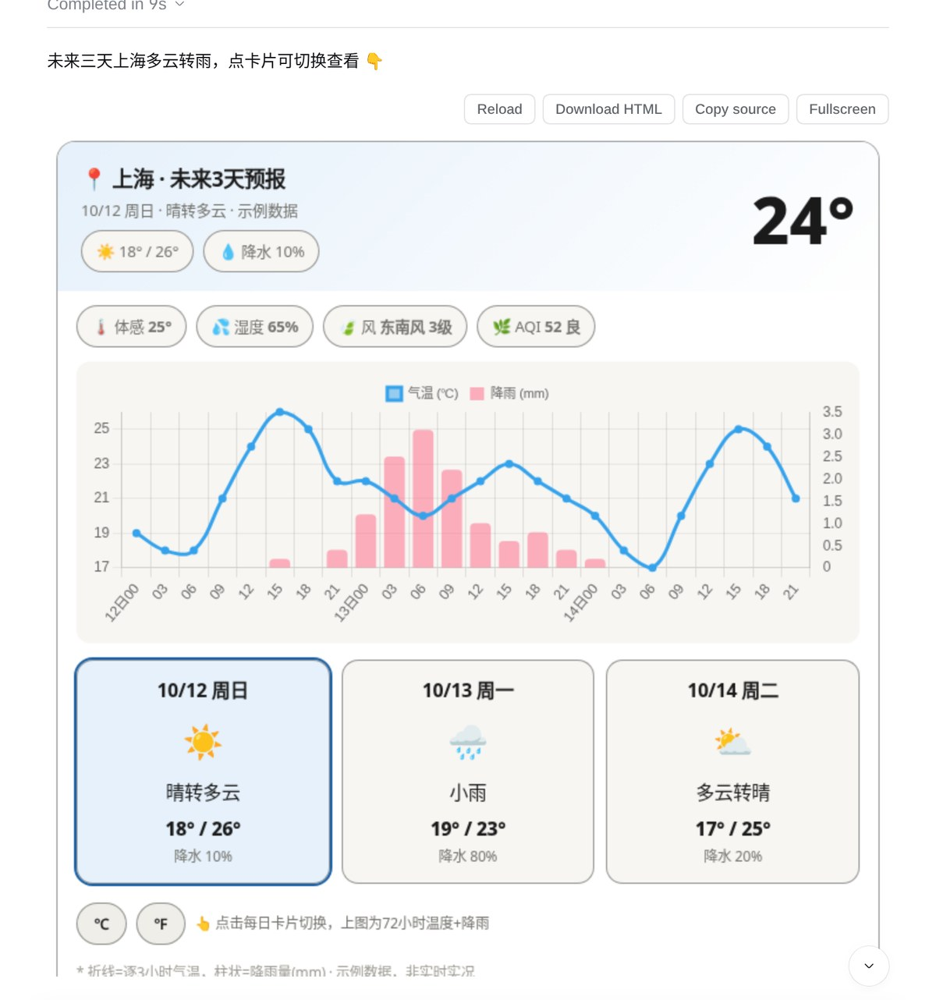
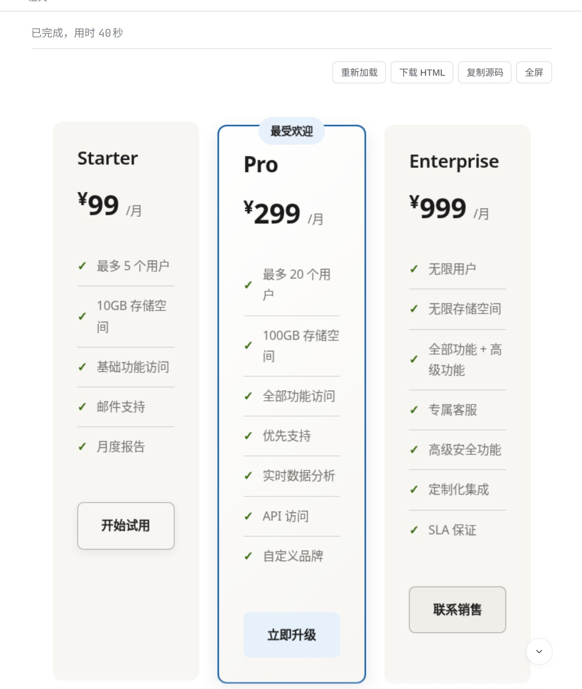
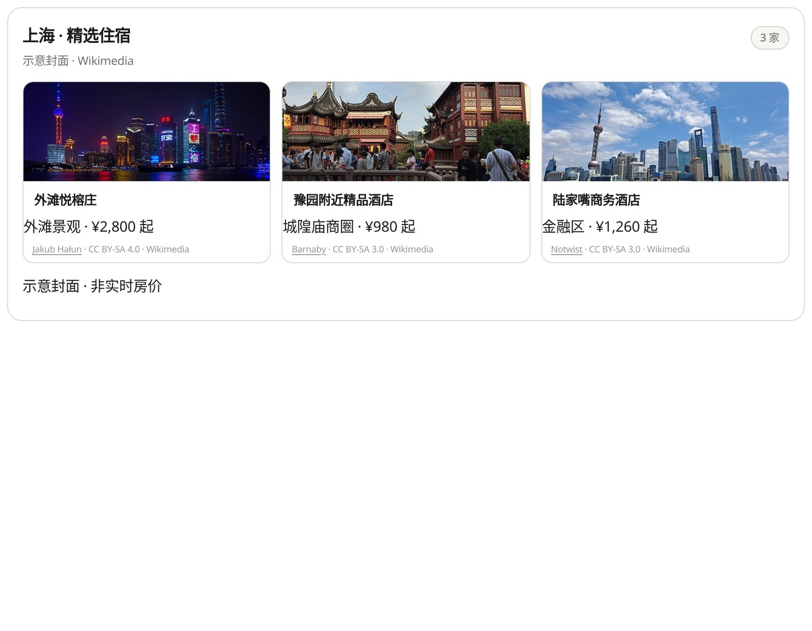
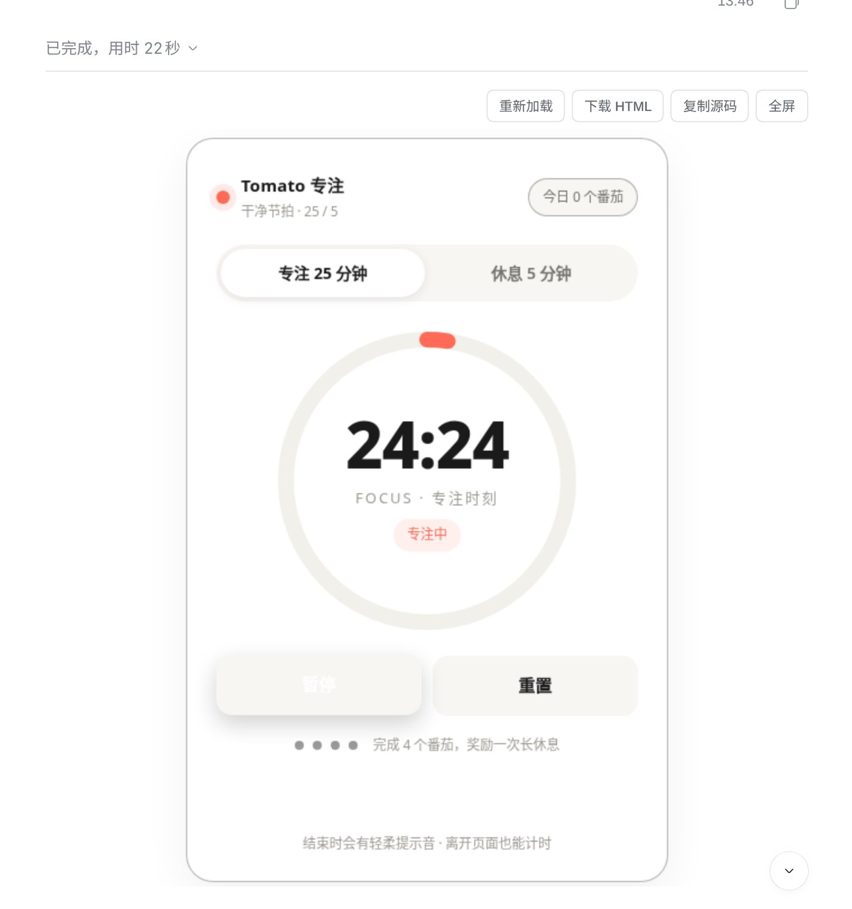
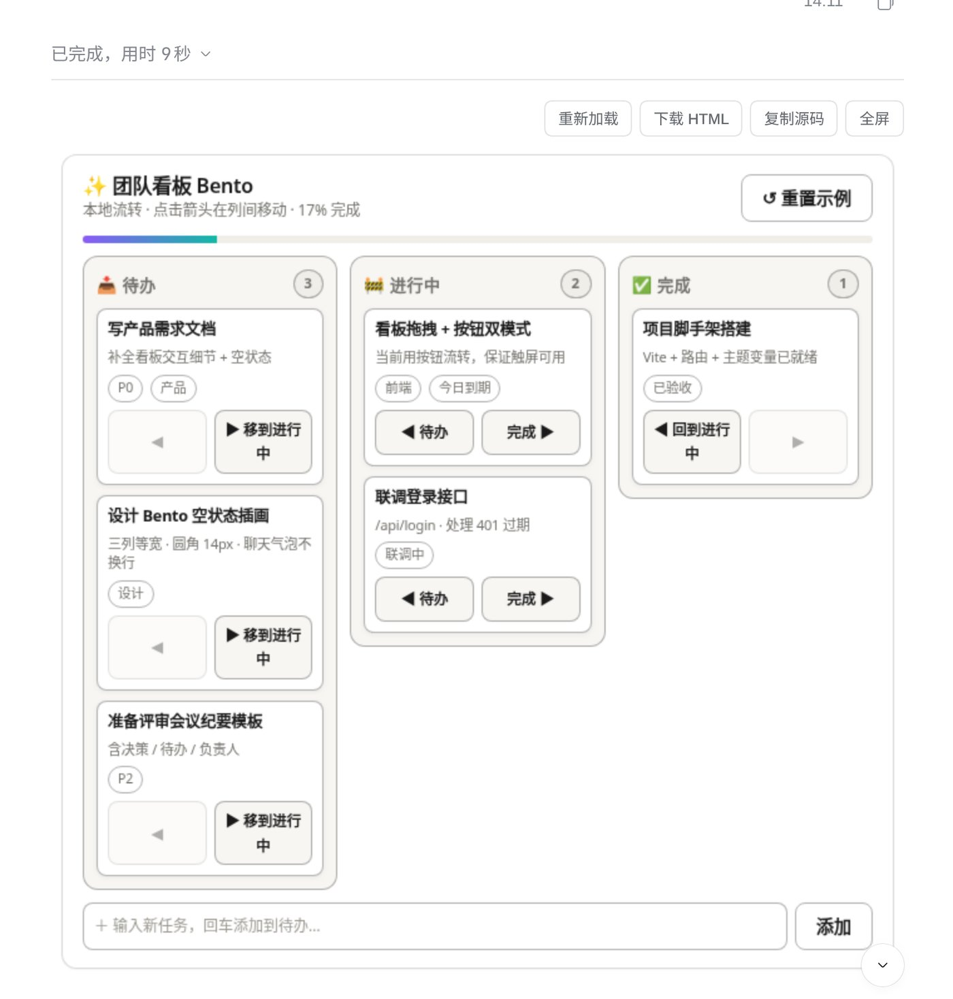
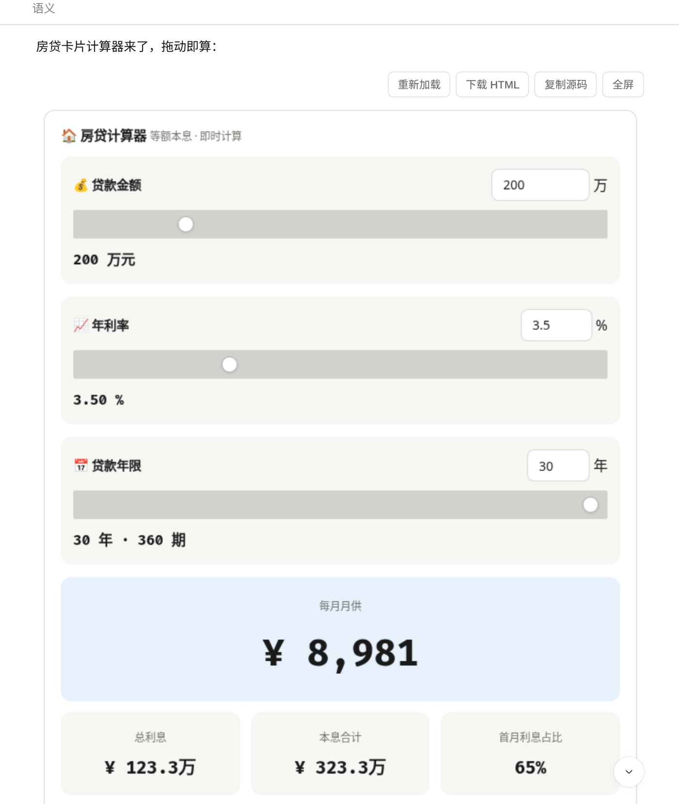

# IUI

[English](./README.md) · **简体中文**

**IUI**（`@losebird/iui`）是 [DeepSeek Harness](https://github.com/deepseek-ai/deepseek-harness)（**dsh**）插件。当回答更适合做成页面时——图表、地图、行程、比价板、小工具——模型可以输出自由 HTML/CSS/JS，IUI 在聊天气泡内的隔离 iframe 中挂载。

| | |
|---|---|
| **包名** | `@losebird/iui` |
| **围栏** | `` ```iui-html `` |
| **许可** | MIT · [LICENSE](./LICENSE) · [NOTICE](./NOTICE) |

---

## 示例

| 行程 | 天气 |
|---|---|
|  |  |

| 定价 | 住宿 |
|---|---|
|  |  |

| 番茄钟 | 看板 |
|---|---|
|  |  |

| 房贷计算器 |
|---|
|  |

---

## 安装

需要 PATH 上有 `dsh`（或用 `npx @deepseek-ai/dsh`）、Node `^22.19 || >=24`，以及可用的 web profile。**不必先 clone。**

```bash
dsh plugin --profile <profile> add github:losebird/IUI
dsh web
```

把 `<profile>` 换成你实际用的（常见是 `web`）。没有全局 `dsh` 时：

```bash
npx @deepseek-ai/dsh plugin --profile <profile> add github:losebird/IUI
npx @deepseek-ai/dsh web
```

打开启动日志里**带 `?token=` 的完整 URL**，硬刷新浏览器。控制台应出现：

```text
[iui] client active; fence-channel=registry|dom
```

设置侧栏应出现 **IUI**。

完整安装说明：[docs/INSTALL.md](./docs/INSTALL.md)

---

## 快速使用

1. 新开会话，选一只有指令遵循力的模型。
2. 问需要「像页面」的内容，例如：*「做一个加州海岸三日行程页，带地图和景点卡。」*
3. 模型闭合 `` ```iui-html `` 围栏后，IUI 会在气泡里挂出可交互页面——而不是残留代码块。

普通文字回答仍是文字；只有围栏会变成页面。

### 围栏

```iui-html
{
  "title": "加州海岸三日行程",
  "height": 560,
  "css": "/* 本页样式 */",
  "html": "<div>…</div>",
  "js": "/* html 就绪后执行 */"
}
```

写作说明：[SKILL.md](./SKILL.md)

---

## 文档

| 文档 | |
|---|---|
| [docs/INSTALL.md](./docs/INSTALL.md) | 安装与验证 |
| [docs/SETTINGS.md](./docs/SETTINGS.md) | 插件设置 |
| [SKILL.md](./SKILL.md) | 围栏与写作约定 |
| [ARCHITECTURE.md](./ARCHITECTURE.md) | 架构概览 |
| [CHANGELOG.md](./CHANGELOG.md) | 版本记录 |

---

## 许可

MIT。见 [LICENSE](./LICENSE) 与 [NOTICE](./NOTICE)。
